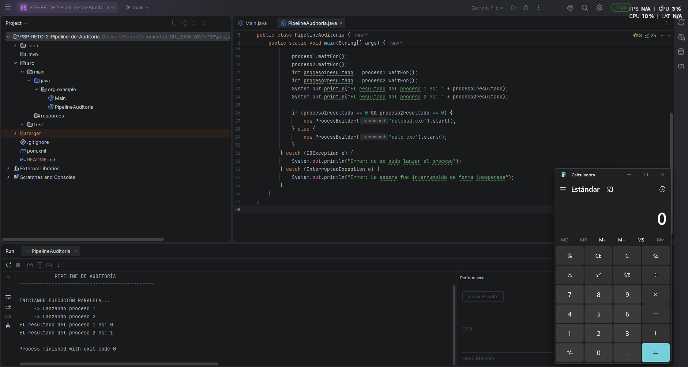

# Reto 2 · Pipeline de Auditoría UDITversum (Fase 1)

**Módulo:** 0490 · Programación de Servicios y Procesos  
**Autor/a:** *Nolan Martínez Gómez*  
**Tecnología:** Java + `ProcessBuilder` (procesos del sistema operativo)  
**Clase principal:** `org.example.PipelineAuditoria`  
**Sistema operativo:** Windows (el código usa `ping -n`, `notepad.exe` y `calc.exe`)  
**RA vinculado:** RA1 · Programación de aplicaciones compuestas por varios procesos

> 💡 **Cómo usar este README:** no es un trámite que se rellena al final. Es tu **cuaderno de pensamiento** durante el reto. Las secciones marcadas con 🧠 sirven para que pienses sobre *cómo* estás pensando. Si las rellenas de golpe en el último minuto pierden todo su valor (y se nota en la defensa oral).
>
> 🗣️ **Importante:** durante la defensa te pediré modificar tu código en directo. Todo lo que escribas aquí debe ser algo que puedas explicar sin mirar la pantalla.

---

## 📺 Qué es esta app

Un programa de consola que simula la **primera fase de una auditoría de UDITversum**. El programa:

1. Lanza **dos comprobaciones (`ping -n 2`) a la vez**, cada una en su propio proceso del sistema operativo: `proceso1` hace ping a `127.0.0.1` (mi propia máquina) y `proceso2` a `x` (un nombre que no se puede resolver, por lo que ese ping falla).
2. **Espera** a que ambas terminen con `waitFor()`.
3. Lee el **código de salida** de cada una y lo guarda en `proceso1resultado` y `proceso2resultado`.
4. Según el resultado combinado, **toma una decisión**: si **los dos** códigos son `0`, abre el **Bloc de Notas** (`notepad.exe`); en **cualquier otro caso**, abre la **Calculadora** (`calc.exe`).

Con las direcciones actuales (`127.0.0.1` y `x`) lo esperado es que se abra la **Calculadora**. Los `ping` no escriben nada en mi consola: el programa no lee su salida, solo usa su código de salida.

```
              ┌─────────────────────┐
              │  PipelineAuditoria  │
              │       (Java)        │
              └──────────┬──────────┘
                 start() │ start()
          ┌──────────────┴──────────────┐
          ▼                             ▼
 ┌─────────────────┐           ┌─────────────────┐
 │    proceso1     │           │    proceso2     │  ← corren a la vez
 │ ping -n 2       │           │ ping -n 2       │
 │ 127.0.0.1       │           │ x               │
 └────────┬────────┘           └────────┬────────┘
          │ waitFor()                   │ waitFor()
          └──────────────┬──────────────┘
                         ▼
¿proceso1resultado == 0 && proceso2resultado == 0?
                         │
              ┌──────────┴──────────┐
              ▼ sí                  ▼ no
         notepad.exe            calc.exe
       (Bloc de Notas)        (Calculadora)
```

📸 ****

---

## 🧠 Antes de empezar: planifico *(5 min, sin tocar el teclado)*

Responde **antes** de escribir una sola línea de código. No importa si te equivocas: lo importante es dejar escrito qué pensabas.

**Con mis palabras, ¿qué me pide el reto?** *(sin copiar el enunciado)*
*(escribe aquí)*

**¿Qué parte del Reto 1 voy a reutilizar tal cual?**
*Reutilizaré tal cual coomo se crean los procesos*

**¿Qué es nuevo respecto al Reto 1 y me da más respeto?**
*Respecto al Reto 1 lo nuevo que hemos implementado es el uso del if y el else para decidir si se abre la calculadora o el bloc de notas*

**Mi plan en 4-5 pasos, en orden:**
1. *Crear procesos*
2. *Comienzo del proceso con .start()*
3. *Esperar con el waitFor() al segundo proceso para que los 2 sean paralelos*
4. *Comparo los procesos*
5. *Mostrar por pantalla el resultaddo de los procesos y abrir la respectiva app, calculadora o bloc de notas*

**Predicciones** *(comprueba al final si acertaste)*

| Escenario | ¿Qué código de salida espero en cada ping? | ¿Qué aplicación se abre? |
|---|---|---|
| Los dos pings a `127.0.0.1` | *0 y 0* | *Bloc de notas* |
| Un ping válido y otro a una dirección inexistente | *0 y 1* | *Calculadora* |
| Los dos pings a direcciones inexistentes | *1 y 1* | *Calculadora* |

**Predicción de tiempo:** si cada ping tarda unos 3 segundos, ¿cuánto tardará mi programa en total si los lanzo en paralelo? ¿Y si los lanzara uno detrás de otro?
*Si los lanzo en paralelo el programa tardará 3 segundos y si los lanzo secuencialmente el programa tardará 6 segundos*

---

## 🎯 Objetivo del reto

Dar el salto de **gestionar un proceso tras otro** (Reto 1) a **coordinar varios procesos simultáneos**, aplicando:

- Creación de procesos con `ProcessBuilder` y `start()`.
- **Ejecución concurrente:** lanzar ambos procesos antes de esperar a ninguno.
- Sincronización con `waitFor()` y lectura del **código de salida**.
- **Lógica condicional** (`if` con `&&` / `||`) para decidir en función de varios resultados.
- Gestión de errores con `try/catch` (`IOException`, `InterruptedException`).

---

## 🛠️ Componentes y conceptos utilizados

> Rellena la columna **"con mis palabras"** *sin mirar tus apuntes*. Después compara con ellos y corrige en otro color o con un comentario. Esa diferencia es exactamente lo que aún no tienes del todo claro.

| Componente / concepto | Para qué se usa en esta app | Con mis palabras |
|---|---|---|
| `ProcessBuilder` | Prepara la orden que se enviará al sistema operativo (ping, notepad, calc). **En mi código:** `ping -n 2 127.0.0.1`, `ping -n 2 x`, `notepad.exe` y `calc.exe`, con cada argumento en su propio `String` | |
| `start()` | Lanza de verdad el proceso y **devuelve el control enseguida**, sin esperar. **En mi código:** lanza `proceso1` y `proceso2` seguidos y, al final, la aplicación que se abre | |
| `Process` | Objeto con el que controlo cada proceso ya en marcha. **En mi código:** `proceso1` y `proceso2` | |
| `waitFor()` | Bloquea mi programa hasta que ese proceso termina y devuelve su código de salida. **En mi código:** se usa sobre `proceso1` y `proceso2`, y el `int` se guarda en `proceso1resultado` y `proceso2resultado` | |
| Código de salida (`int`) | Dice cómo terminó el proceso: `0` = éxito, distinto de `0` = fallo. **En mi código:** los dos códigos se imprimen y se comparan con `0` en el `if` | |
| `&&` (AND) | Se cumple solo si **las dos** condiciones son verdaderas. **En mi código:** `proceso1resultado == 0 && proceso2resultado == 0` | |
| `\|\|` (OR) | Se cumple si **al menos una** condición es verdadera. **En mi código:** no lo uso; es el operador contrario al que uso (ver tabla de verdad) | |
| `try/catch` | Captura errores que Java no puede evitar (el SO no encuentra el programa, etc.). **En mi código:** un único `try` que envuelve todo el `main`, con un `catch` para `IOException` y otro para `InterruptedException` | |
| `InterruptedException` | Excepción que obliga a gestionar `waitFor()` por si el hilo es interrumpido. **En mi código:** muestra «Error: La espera fue interrumpida de forma inesperada» | |

**¿Cómo se llaman mis dos objetos `Process` y qué lanza cada uno?**
`proceso1` lanza `ping -n 2 127.0.0.1` (mi propia máquina, debería responder) y `proceso2` lanza `ping -n 2 x` (un nombre que no se puede resolver, debería fallar).

---

## 🔀 Secuencial vs paralelo: el corazón de este reto

Lo que separa un buen Reto 2 de uno que "funciona pero no cumple" es **dónde pones los `waitFor()`**. Compara las dos líneas de tiempo (suponiendo que cada ping tarda 3 s):

**❌ Secuencial** (`waitFor()` antes del segundo `start()`):

```
t=0s   start(ping A) ──────────── waitFor() ── termina en t=3s
t=3s                              start(ping B) ──────────── waitFor() ── termina en t=6s
                                                                          TOTAL ≈ 6 s
```

**✅ Paralelo** (los dos `start()` primero, los `waitFor()` después):

```
t=0s   start(ping A) ─┐
t=0s   start(ping B) ─┤  los dos procesos corren a la vez
t=3s   waitFor(A) ✔  waitFor(B) ✔
                                  TOTAL ≈ 3 s
```

**Mi orden real de llamadas, copiado de mi código** *(pega solo las líneas relevantes)*:

```java
Process proceso1 = new ProcessBuilder("ping", "-n", "2", "127.0.0.1").start();
Process proceso2 = new ProcessBuilder("ping", "-n", "2", "x").start();

proceso1.waitFor();
proceso2.waitFor();
```

En mi código hay **dos `start()` seguidos** y **dos llamadas a `waitFor()`**.

---

## 🔢 Tabla de verdad de mi decisión

Completa con **tu** lógica real (la del enunciado):

Ping A = `proceso1` (`127.0.0.1`) · Ping B = `proceso2` (`x`) · Condición real: `proceso1resultado == 0 && proceso2resultado == 0` → Bloc de Notas; en cualquier otro caso → Calculadora.

| Código ping A | Código ping B | ¿Ping A OK? | ¿Ping B OK? | Condición (`&&` / `\|\|`) | Aplicación que abro |
|---|---|---|---|---|---|
| 0 | 0 | Sí | Sí | `true && true` → `true` | `notepad.exe` (Bloc de Notas) |
| 0 | ≠ 0 | Sí | No | `true && false` → `false` | `calc.exe` (Calculadora) ◀ *mi configuración actual* |
| ≠ 0 | 0 | No | Sí | `false && true` → `false` | `calc.exe` (Calculadora) |
| ≠ 0 | ≠ 0 | No | No | `false && false` → `false` | `calc.exe` (Calculadora) |

**¿Cambiaría el resultado de alguna fila si cambiara `&&` por `||`? ¿En cuáles?**
*Sí cambiaría, en las filas 2 y 3*

---

## 🚀 Cómo ejecutar el proyecto

1. Clonar o abrir el proyecto en IntelliJ IDEA.
2. Esperar a que indexe el proyecto.
3. Ejecutar (▶) la clase principal.

⚠️ **Dependencia del sistema operativo:** `ping` usa `-n` en Windows y `-c` en Linux/Mac, y `notepad.exe` / `calc.exe` solo existen en Windows. **Mi código escribe `-n`, `notepad.exe` y `calc.exe` a mano, así que solo funciona en Windows.** Lo he probado en: *(escribe aquí tu versión de Windows y de Java)*

---

## 🔍 Mientras programo: mi diario de decisiones

Cada vez que te atasques, cambies de idea o algo falle, anota una entrada. Tres líneas bastan. No se trata de quedar bien: se trata de que dentro de un mes puedas reconstruir **cómo pensaste**.

| Qué intentaba | Qué pasó realmente | Qué hice / qué aprendí |
|---|---|---|
| *(ejemplo)* Que los dos pings corrieran a la vez | El programa tardaba el doble de lo esperado | Me di cuenta de que había puesto un `waitFor()` entre los dos `start()` y... |
| Simular un ping que falla | Con x el ping no daba error de Java, solo devolvía un código distinto de 0 | Entendí que “el ping falla” y “no se puede lanzar el programa” son cosas distintas: lo primero es un código de salida y lo segundo una IOException |
| Guardar el código de salida | Vi que waitFor() devuelve un int | Lo guardé en proceso1resultado y proceso2resultado para usarlo en el if y mostrarlo |
| Manejar los errores | waitFor() obliga a capturar InterruptedException y start() obliga a capturar IOException | Puse un solo try con dos catch para que cada error tenga su mensaje |

**Mi pregunta-brújula cuando me bloqueo:**
1. ¿Qué espero que haga esta línea?
2. ¿Qué está haciendo realmente? *(imprimo valores para comprobarlo)*
3. ¿En qué punto exacto se separan las dos respuestas?

---

## 🧠 Análisis técnico (preparación para la defensa)

> Responde de forma clara y **con tus propias palabras**. Estas preguntas serán la base de tu evaluación oral. Las pistas en cursiva son para orientarte, no para copiarlas.

### 1. Secuencial vs paralelo

**¿Qué líneas exactas garantizan que los dos pings se ejecutan a la vez? ¿Qué ocurriría físicamente si pusieras el primer `waitFor()` justo antes de lanzar el segundo `start()`?**

*Lo que hace que los dos pings corran a la vez son estas dos líneas, que van seguidas y antes de cualquier waitFor():

```java
Process proceso1 = new ProcessBuilder("ping", "-n", "2", "127.0.0.1").start();
Process proceso2 = new ProcessBuilder("ping", "-n", "2", "x").start();
```

start() le pide al sistema operativo que cree el proceso y devuelve el control enseguida, sin esperar a que termine. El ping lo ejecuta el sistema operativo, no mi programa, así que cuando llego al segundo start() el primer ping ya está corriendo por su cuenta y existen los dos a la vez.

Si pusiera el primer waitFor() justo antes del segundo start(), mi hilo principal se bloquearía hasta que terminara proceso1. El segundo ping no se lanzaría hasta entonces, así que solo habría un ping en marcha cada vez y el programa sería secuencial. Con el ejemplo de 3 s por ping, tardaría unos 6 s en vez de unos 3 s.*

### 2. El código de salida (exit code)

**¿Qué tipo de dato devuelve `waitFor()`? ¿Qué significa en el estándar de los sistemas operativos que ese valor sea `0` o distinto de `0`?**

*waitFor() devuelve un int. Por convención de los sistemas operativos, 0 significa que el proceso terminó bien y cualquier valor distinto de 0 significa que hubo algún problema. El éxito es una sola cosa y los fallos pueden ser de muchos tipos, así que el 0 se reserva para el éxito y los demás números sirven para distinguir qué falló (cada programa define el significado de los suyos). En mi código solo comparo con 0, sin distinguir el tipo de fallo.

“El ping falló” no es lo mismo que “el programa ping no pudo ejecutarse”. En el primer caso el proceso arrancó, hizo su trabajo y terminó con un código distinto de 0 (es lo que pasa con x). En el segundo, Java ni siquiera consigue arrancarlo, no hay código de salida y salta una IOException.*

### 3. Lógica condicional

**Escribe aquí la condición `if` exacta que has programado. Explica por qué has utilizado `&&` o `||` para decidir si abrir el Bloc de Notas o la Calculadora.**

```java
if (proceso1resultado == 0 && proceso2resultado == 0) {
    new ProcessBuilder("notepad.exe").start();
} else {
    new ProcessBuilder("calc.exe").start();
}
```

*Usé && porque quiero abrir el Bloc de Notas solo si los dos pings han ido bien. Es como una auditoría en la que todo tiene que pasar, y si cualquiera falla se abre la Calculadora por el else. Si uno falla y el otro no, la condición es falsa y se abre la Calculadora.

Con || bastaría que uno de los dos funcionara, y cambiaría el resultado en las filas 2 y 3 de mi tabla de verdad (0 / ≠0 y ≠0 / 0), donde se abriría el Bloc de Notas aunque un ping hubiera fallado. Con mis direcciones actuales (127.0.0.1 y x) estoy en la fila 2, así que se abre la Calculadora.*

### 4. Gestión de excepciones

**Tu código incluye un bloque `try/catch`. Describe una situación real (un fallo del sistema o una mala configuración) que provocaría que tu programa entrase en el `catch` de `IOException`.**

*Un caso real: ejecutar el programa en Linux o Mac. Los pings se lanzarían, pero new ProcessBuilder("notepad.exe").start() lanzaría una IOException porque ese ejecutable no existe en ese sistema, y el programa mostraría “Error: no se pudo lanzar el proceso”. Pasaría lo mismo si escribiera mal el nombre (notepd.exe) o si ping no estuviera disponible en el sistema.

La diferencia con x es que ahí el ping sí se lanza correctamente y termina con un código distinto de 0. No hay excepción y el programa sigue por el else hacia la Calculadora. La IOException solo salta cuando Java no consigue ni arrancar el proceso.*

---

## (Reto 2: Actualización Crítica en Producción (Laboratorio Multiproceso))

### 5. Mundo real: ¿qué sistemas profesionales utilizan esta lógica de health checks (comprobaciones de estado de servicios)?

*Esta lógica de comprobación de estados (health checks) es fundamental en la arquitectura de sistemas modernos y se utiliza constantemente en entornos de producción:

-Orquestadores de contenedores: Herramientas como Kubernetes o Docker Swarm realizan comprobaciones de vida (liveness y readiness probes) de forma continua para saber si un contenedor está funcionando o si se ha quedado colgado, procediendo a reiniciarlo automáticamente si falla.

-Balanceadores de carga y pasarelas de API: Sistemas como Nginx, HAProxy o los balanceadores en la nube (AWS ALB, Google Cloud Load Balancer) lanzan pings o peticiones HTTP periódicas a los servidores backend. Si detectan que uno no responde, dejan de enviarle tráfico de usuarios para evitar errores.

-Sistemas de monitorización: Herramientas como Nagios, Prometheus o Datadog vigilan la disponibilidad de redes, bases de datos y microservicios para alertar a los administradores de sistemas ante una caída.*

### 6. Reflexión sobre tus tiempos: viendo los tiempos que has medido, si auditaras 50 servidores lentos, ¿cuánto tardaría el programa de forma secuencial y cuánto en paralelo?

*-De forma secuencial: Si el programa lanzara un ping tras otro esperando a que cada uno termine, al tardar cada timeout 3 segundos, el cálculo sería $50 \text{ servidores} \times 3 \text{ segundos} = \textbf{150 segundos}$ (2 minutos y medio). El tiempo aumentaría linealmente con cada servidor añadido.
-En paralelo (concurrente): Gracias a la arquitectura basada en procesos concurrentes que hemos implementado, todos los pings se lanzan a la vez. Por lo tanto, el programa no espera la suma de todos, sino que finaliza cuando responde el proceso más lento. El tiempo total seguiría rondando los 3 segundos (más un mínimo margen de milisegundos que tarde el sistema operativo en planificar los 50 procesos simultáneos).*

---

## 🛡️ Preparación para la defensa: ¿sabría hacer esto en directo?

Durante la defensa te pediré pequeñas modificaciones. Practica estas **antes** de entregar y marca las que ya sabes hacer sin ayuda:

- ☒ Cambiar la condición para que se abra la Calculadora **solo si falla uno de los dos pings**.
- ☒ Añadir un **tercer ping** en paralelo y que la decisión dependa de los tres.
- ☒ Mostrar el **PID** de cada proceso al lanzarlo.
- ☒ Medir y mostrar **cuántos milisegundos** tarda en total el programa.
- ☐ Hacer que el programa funcione en **Linux** (cambiar `-n` por `-c` y las apps a abrir).
- ☐ Provocar a propósito una `IOException` y mostrar un mensaje claro al usuario.
- ☒ Explicar qué pasaría si quito el `waitFor()`.

**¿Cuál me costó más y por qué?**
*Hacer que el programa funcione en Linux ya que no tengo una máquina virtual*

---

## 🧭 Del Reto 1 al Reto 2: cómo di el salto

El Reto 1 lanzaba procesos **uno tras otro** dentro de un bucle. El Reto 2 los lanza **a la vez**. Explica ese salto con tus palabras:

**¿Qué hacía mi Reto 1 que aquí ya no me sirve tal cual?**
*Lanzaba y esperaba cada proceso dentro del mismo bucle. Cada vuelta se bloqueaba hasta que terminaba el proceso, así que nunca había dos a la vez.*

**¿Qué he tenido que cambiar para que dos procesos corran simultáneamente?**
*Separar el lanzamiento de la espera: primero todos los start() y después todos los waitFor().*

**¿Qué ventaja tiene lanzar en paralelo? ¿Y qué problema nuevo aparece cuando dependo de dos resultados a la vez?**
*El tiempo total es el del proceso más lento, no la suma de todos. El problema nuevo es que ahora dependo de varios resultados y tengo que combinarlos en una sola decisión con && / ||.*

**Si mañana el pipeline tuviera 50 comprobaciones en lugar de 2, ¿seguiría teniendo sentido mi estructura de código? ¿Qué cambiaría?**
*No. Copiar 50 start() y 50 waitFor() no escala. Guardaría los procesos en una List<Process>, con un bucle para lanzarlos todos y otro para esperarlos y acumular si todos devolvieron 0.*

---

## 🧠 Qué he aprendido

> *(Completar al terminar. Redacta con tus palabras, no con las del enunciado.)*

- **`start()` vs `waitFor()`:** lanzar un proceso y esperarle son cosas distintas porque start() solo pide al sistema operativo que cree el proceso y devuelve el control al instante, mientras que waitFor() bloquea mi hilo hasta que termina y me da su código.
- **Paralelismo real:** dos procesos corren "a la vez" porque cada ping lo ejecuta el sistema operativo como proceso independiente y yo lanzo los dos antes de esperar a ninguno.
- **Código de salida:** que sea `0` o distinto de `0` significa que el proceso terminó bien y distinto de 0 que hubo algún problema. Es lo único que usa mi programa para decidir, porque no lee lo que escribe el ping.
- **`&&` vs `||`:** elegí el operador que elegí porque el Bloc de Notas solo debe abrirse si los dos pings funcionan. Con || cambiaría el resultado en las filas donde uno falla y el otro no.
- **`IOException` vs ping fallido:** la diferencia entre ambos es con un ping fallido el proceso arranca y termina con un código distinto de 0 (como con x). La IOException salta cuando Java ni siquiera consigue arrancar el proceso (por ejemplo, notepad.exe en Linux).
- **Fiabilidad de mi decisión:** lo que mi programa decide se basa en el código de salida de ping. Sirve para saber si hubo respuesta, pero no dice por qué falló. Podría equivocarse si un equipo está activo pero bloquea el ping, o si hay un fallo puntual de red que haga fallar la comprobación aunque el servicio esté bien.

---

## 🐞 Dificultades y cómo las resolví

> *(Completar antes de entregar. Reúne lo más importante de tu diario de decisiones.)*

**Dificultad 1:**
- Qué síntoma vi: al revisar el código vi cuatro waitFor() seguidos.
- Cuál era la causa real: las dos primeras llamadas no guardaban el valor y las otras dos volvían a esperar, así que eran redundantes.
- Cómo la encontré (¿apuntes? ¿documentación oficial? ¿depuración?): revisando el código línea a línea (si te lo señaló una revisión externa, dilo así).
- Cómo evitaré que me vuelva a pasar: un solo waitFor() por proceso, guardando el valor en la misma línea.

**Dificultad 2:**
- Qué síntoma vi: con una IP inexistente no entraba en el catch.
- Cuál era la causa real: un ping fallido no es una IOException; el proceso arranca bien y devuelve un código ≠ 0.
- Cómo la encontré: apuntes de clase y documentación oficial de ProcessBuilder.
- Cómo evitaré que me vuelva a pasar: comprobar siempre el código de salida, no esperar una excepción.

---

## 🪞 Autoevaluación

Marca con honestidad, no con optimismo. Nadie te califica esta sección: es para ti y para que el profesor sepa dónde ayudarte.

| Puedo explicar a un compañero… | 🔴 No | 🟡 Más o menos | 🟢 Sí |
|---|:---:|:---:|:---:|
| Qué hace `ProcessBuilder` | ☐ | ☐ | ☒ |
| Por qué `start()` no espera | ☐ | ☐ | ☒ |
| Qué línea hace que mis procesos sean paralelos | ☐ | ☐ | ☒ |
| Qué pasaría si moviera el `waitFor()` | ☐ | ☐ | ☒ |
| Qué devuelve `waitFor()` y qué significa `0` | ☐ | ☐ | ☒ |
| Por qué uso `&&` / `\|\|` en mi condición | ☐ | ☐ | ☒ |
| Cuándo se entra en el `catch` de `IOException` | ☐ | ☐ | ☒ |

**Mis predicciones del principio, ¿acerté?** *Sí en los tres escenarios (0/0 → Bloc de Notas; 0/≠0 y ≠0/≠0 → Calculadora) y en el tiempo (≈ 3 s en paralelo, ≈ 6 s en secuencial). Me equivoqué en el plan: dije que el waitFor() hacía el paralelismo, pero lo hace lanzar los dos start() antes de esperar.*

**Lo que haría diferente si empezara de nuevo:**
*Escribiría primero la tabla de verdad y después el if, y mediría el tiempo desde el principio para comprobar el paralelismo.*

**Lo que todavía no tengo claro y quiero preguntar en clase:**
*Qué ocurre si un proceso se queda colgado y nunca termina, y cómo poner un tiempo máximo de espera (waitFor con timeout).*

---

## 🤝 Declaración de autoría y aprendizaje

Este reto no **permite herramientas de IA generativa**. Consulté únicamente: los apuntes de clase, la documentación oficial de Java e IntelliJ IDEA.

☒ Confirmo que he diseñado, programado y depurado este código aplicando mi propio razonamiento, y que puedo explicarlo línea a línea.

☒ Entiendo que durante la defensa el profesor me pedirá realizar pequeñas modificaciones sobre este código para comprobar mi comprensión del multiproceso.

---

## 📂 Estructura del proyecto

```
src/main/java/org/example/PipelineAuditoria.java   → clase con el main (el pipeline de auditoría)
README.md                                          → este documento
```

*(Si tu proyecto tiene más archivos, p. ej. `pom.xml`, añádelos aquí.)*

## 🔗 Enlace

GitHub: [MrSonbi/psp_udit · PSP-RETO-2-Pipeline-de-Auditoria](https://github.com/MrSonbi/psp_udit/tree/main/PSP-RETO-2-Pipeline-de-Auditoria)